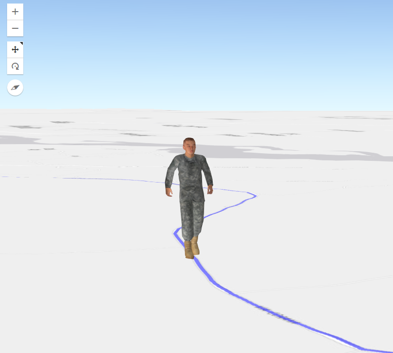

# externalRendererSkeleton

A historical **ArcGIS API for JavaScript 4.1** sample showing how to animate a skinned Three.js character inside an ArcGIS `SceneView` using an external renderer.



**[Live demo](https://nicogis.github.io/externalRendererSkeleton/)** — click the scene to start the predefined animation.

## About this sample

This repository preserves an implementation originally developed in **2016–2017**. It uses the external renderer interface available in ArcGIS API for JavaScript 4.1 and an older Three.js animation API. It is intended as a historical learning example, **not** as a current production-ready integration or a template compatible with recent ArcGIS/Three.js releases.

- ArcGIS SceneView and `externalRenderers` share a WebGL rendering context.
- Three.js draws a skinned marine model on an example path in Web Mercator.
- The character blends idle, walking and running animations.
- Map clicks trigger the example; the path is predefined rather than calculated from the clicked position.

## Run locally

Serve the repository root over HTTP(S), rather than opening `index.html` directly via `file://`, so that the browser can load the local model and animation assets.

For example, with Python installed:

```bash
python -m http.server 8000
```

Open `http://localhost:8000/`, then click the scene. A working internet connection is required for the hosted ArcGIS API and map services.

> **Compatibility note:** This is legacy code. Modern browsers, ArcGIS service authentication requirements and changes to remote endpoints can affect whether the demo still runs. The hosted demo link is provided for reference, not as a verified availability guarantee.

## Project layout

| Path | Purpose |
| --- | --- |
| `index.html` | ArcGIS scene, example route and external renderer |
| `js/BlendCharacter.js` | Legacy Three.js skinned-character animation helper |
| `js/BlendCharacterGui.js` | Legacy animation controls |
| `js/libs/` | Vendored legacy versions of Three.js, dat.gui and stats.js |
| `models/skinned/marine/` | Character model, animation exports and Blender source files |
| `img/Skeleton.png` | Demo screenshot |

## Technical notes

- The example route is embedded in the code; a route-service endpoint remains in the original sample for historical context, but no route service request is executed in the demonstrated flow.
- The model's source files are retained to preserve the original demonstration. Some included data files are large and are not required for everyday source-code review.
- Updating to the current ArcGIS Maps SDK for JavaScript and current Three.js requires a separate integration and animation migration, not simply replacing the script URLs.

## Third-party code and assets

This repository includes vendored JavaScript libraries and a marine character model derived from historical Three.js examples. **Do not assume those dependencies or model assets share the same license as original NicoGIS code.** Review the upstream licenses and asset provenance before redistribution, adaptation or commercial use.

Relevant upstream references:
- [Three.js](https://github.com/mrdoob/three.js)
- [ArcGIS Maps SDK for JavaScript](https://developers.arcgis.com/javascript/latest/)
- [dat.gui](https://github.com/dataarts/dat.gui)
- [stats.js](https://github.com/mrdoob/stats.js)

## Maintenance

This is a preserved legacy demonstration. Issues and pull requests should distinguish bug fixes compatible with the original API from modernization requests. No automated browser integration tests are currently provided.
